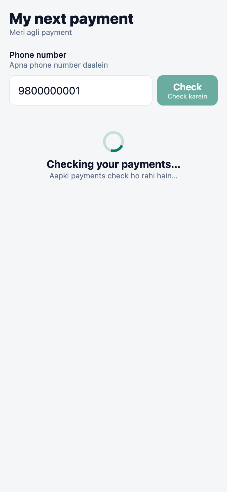
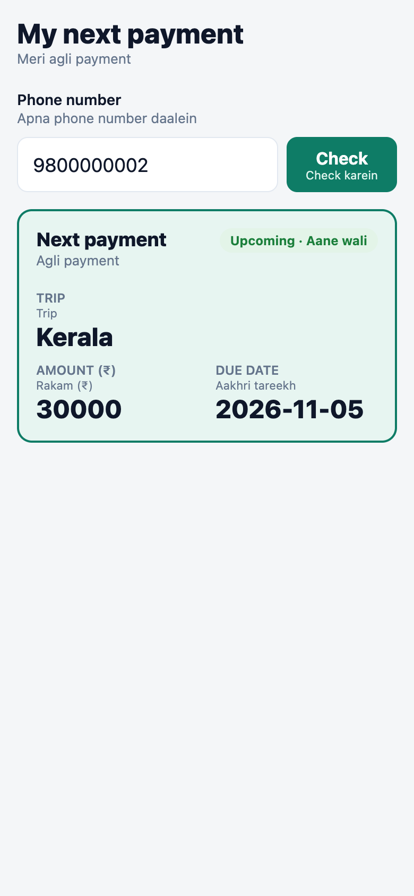
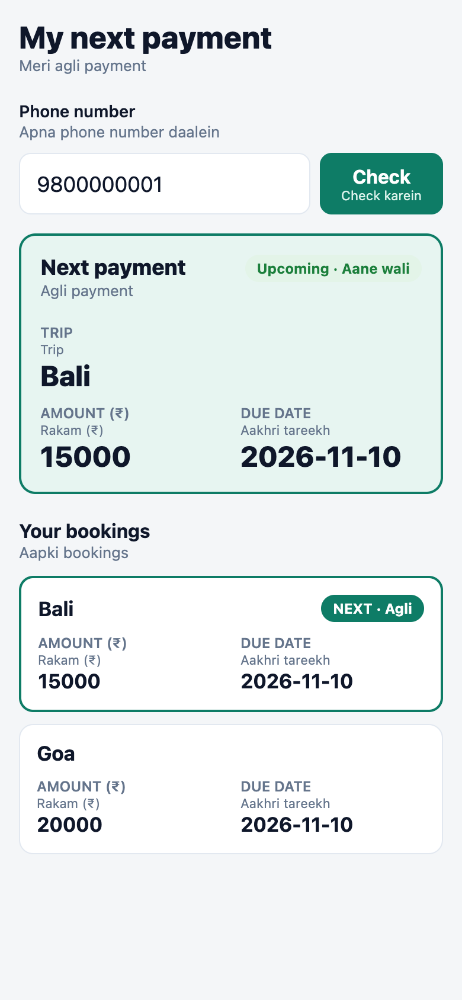
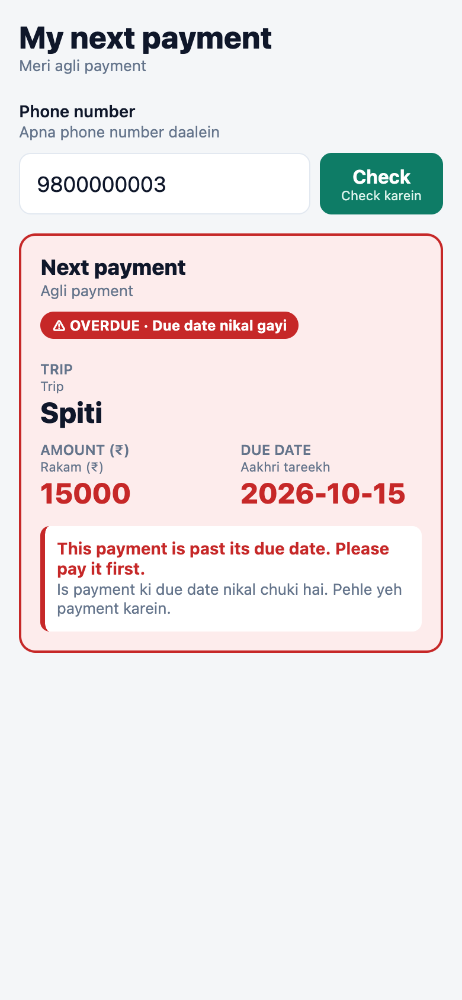
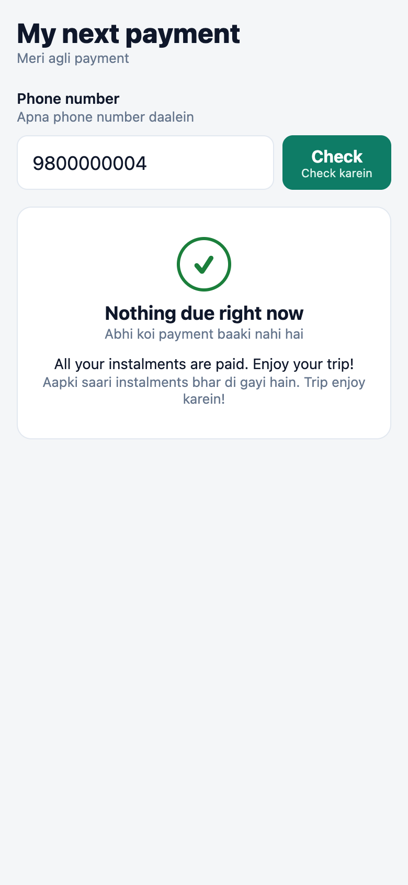
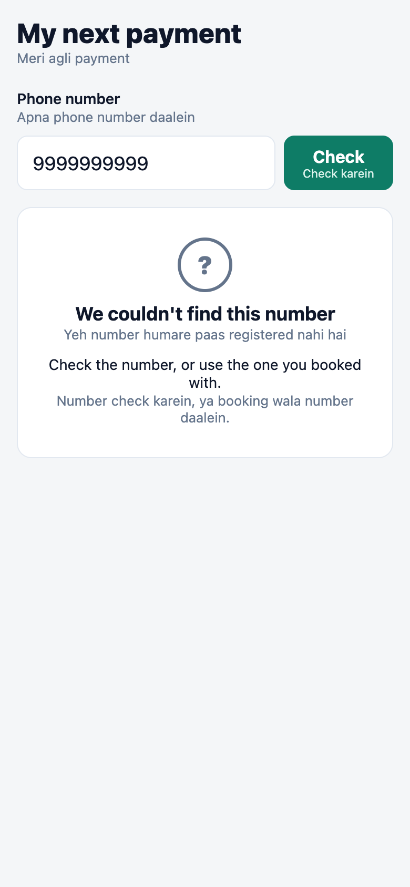
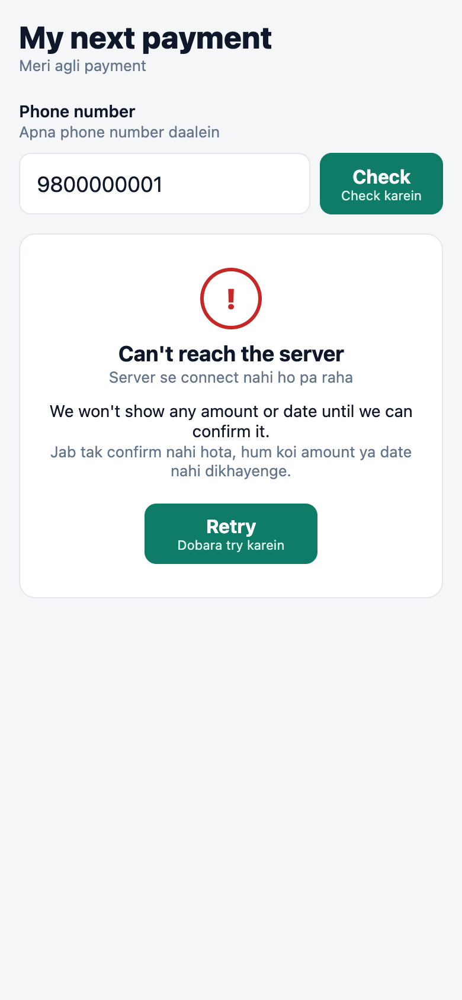

# Travellers Kitty: "What is my next payment?"

A traveller pays for a trip in instalments and asks *"what is my next payment?"*. This repo answers that **only from the database**:

| Part | What | Where |
|---|---|---|
| 1 | SQL: schema, seed, queries Q1–Q6, index notes | [`sql/solution.sql`](sql/solution.sql) |
| 2 | API: `GET /next-payment` (Python, FastAPI, SQLite) + 22 tests | [`api/`](api) |
| 3 | React Native screen "My next payment" (Expo) | [`app/`](app) |
| 4 | WhatsApp assistant note | [`NOTE.md`](NOTE.md) |
| – | Screenshots of all 7 states + video | [`screenshots/`](screenshots) |

The three rules are handled like this:

1. **Every amount and date comes from the DB.** The API copies query rows into JSON, and the app prints those fields exactly as received (`15000`, `2026-11-10`). There is no formatting, no maths and no fallback values.
2. **API down means no data on screen.** Only the `ok` result type carries amounts and dates. Any network error, timeout (8 s), non-200 response or malformed JSON becomes `error`, which carries nothing. Starting a new request clears the old result first.
3. **"Today" is a parameter.** `today=2026-10-26` is required by the API (400 if missing or invalid). The app sends it from config (`EXPO_PUBLIC_TODAY`). No code reads the system clock, and a test proves it by changing `today` and watching `overdue` change.

---

## Run it on a fresh machine

**You need:** [Git](https://git-scm.com), [Python 3.10+](https://www.python.org/downloads/) and [Node.js 20+ LTS](https://nodejs.org). Expo Go on your phone is optional.

### 1. API (terminal 1)

```bash
cd api
python3 -m venv .venv
source .venv/bin/activate          # Windows: .venv\Scripts\activate
pip install -r requirements.txt
uvicorn app.main:app --host 0.0.0.0 --port 8000
```

On first start, the API builds `api/data/kitty.db` from the schema and seed blocks in `sql/solution.sql`. To check it:

```bash
curl "http://localhost:8000/next-payment?phone=9800000001&today=2026-10-26"
```

### 2. Tests

```bash
cd api && source .venv/bin/activate
pytest -q                          # 22 passed
```

### 3. App (terminal 2)

```bash
cd app
npm install
npx expo start --web               # opens http://localhost:8081
```

- **iOS simulator / Android emulator:** run `npx expo start`, then press `i` or `a`. For the Android emulator, set `EXPO_PUBLIC_API_URL=http://10.0.2.2:8000`.
- **Real phone (Expo Go):** the phone can't reach your laptop's `localhost`. Use your laptop's LAN IP, for example `EXPO_PUBLIC_API_URL=http://192.168.1.20:8000 npx expo start`, and scan the QR code. Phone and laptop must be on the same Wi-Fi.

| Env var | Default | Meaning |
|---|---|---|
| `EXPO_PUBLIC_API_URL` | `http://localhost:8000` | API base URL |
| `EXPO_PUBLIC_TODAY` | `2026-10-26` | "today" sent to the API |

Test phone numbers: `9800000001` Asha (two bookings, tie), `9800000002` Rohit (one booking), `9800000003` Meera (overdue), `9800000004` Neha (nothing due). Any other number is unknown.

### 4. Re-capture screenshots (optional)

With the API and the web app running:

```bash
api/.venv/bin/pip install playwright
api/.venv/bin/playwright install ffmpeg   # for the video
api/.venv/bin/python scripts/capture_screens.py
```

This script is also an end-to-end test. It drives the real app through all 7 states and checks what is on screen. For example, after the API goes down, it checks that none of `15000`, `2026-11-10`, `Bali` or `Goa` is still visible. It uses your installed Chrome; pass `--bundled` after `playwright install chromium` to use Playwright's own browser instead.

---

## Screenshots: all 7 states

| 1. Loading | 2. One booking | 3. Two bookings, next highlighted | 4. Overdue |
|---|---|---|---|
|  |  |  |  |

| 5. Nothing due | 6. Unknown number | 7. API down (retry, no old data) |
|---|---|---|
|  |  |  |

Video walkthrough: [`screenshots/walkthrough.webm`](screenshots/walkthrough.webm). It shows all seven states, plus Retry recovering once the API is back.

Every label is in English with a Hinglish line under it (e.g. *Next payment / Agli payment*, *Overdue / Due date nikal gayi*, *Retry / Dobara try karein*).

---

## Part 1: SQL

One file, [`sql/solution.sql`](sql/solution.sql), written for SQLite. Each block starts with `-- name: …`. The API loads its queries from this same file, so the tested SQL and the served SQL can't drift apart.

| # | Block | Params | Answer on seed data (today 2026-10-26) |
|---|---|---|---|
| Q1 | `next_unpaid_per_booking` | phone, today | Asha: Bali 15000 2026-11-10, Goa 20000 2026-11-10 |
| Q2 | `next_payment` | phone, today | Asha: **Bali** (tie on 11-10; Bali departs 2026-12-10, before Goa) |
| Q3 | `payment_mismatches` | none | #2 Bali partial 15000/30000, #6 Kerala overpaid 60000/30000 |
| Q4 | `duplicate_payments` | none | payments 3 and 4 on instalment #6, 5 min apart |
| Q5 | `overdue_balance` (+ `overdue_balance_all`) | phone, today | Meera 15000; others 0 |
| Q6 | comment block + `find_traveller` | phone | unknown phone gives 0 rows from every query |

Run the whole file:

```bash
sqlite3 -header -column \
  -cmd ".param set :phone \"'9800000001'\"" -cmd ".param set :today \"'2026-10-26'\"" \
  :memory: < sql/solution.sql
```

**Indexes (Q6):**

- `travellers(phone)`: already unique, so already indexed. It is the entry point of every query.
- `bookings(traveller_id)`
- `instalments(booking_id, due_date)`: finds the earliest open instalment per booking in index order.
- `payments(instalment_id, paid_at)`: sums payments per instalment and finds duplicates for the same instalment by time.

### Assumptions (stated, not hidden)

- **Unpaid = instalment amount − sum of its payments.** A partial payment lowers what is due (Asha's Bali shows 15000, not 30000).
- **Over-payments are not carried forward.** Rohit paid instalment #6 twice. That looks like a duplicate charge (Q4), so whether it becomes a refund or a credit is a human decision. The system shows #7 (30000) as still due and flags #6 in Q3 and Q4. Moving money silently would be the worse failure.
- **Overdue means `due_date < today`.** An instalment due *today* is not overdue yet.
- **The next instalment of a booking is its earliest unpaid one,** even if it is overdue.
- **Ties:** earliest due date first, then earlier departure, then booking id, so the result is always the same.
- **Q5 per traveller with a phone parameter.** The brief says every query except Q3 and Q4 takes a phone. `overdue_balance_all` is the admin view across all travellers and is not used by the API.
- **Exactly 10 minutes apart counts as a duplicate.** Times are compared as whole seconds. `julianday()` is a float and made exactly 10 minutes come out as 10.0000001; a test caught this.

---

## Part 2: API

`GET /next-payment?phone=9800000001&today=2026-10-26`

```json
{
  "status": "ok",
  "next": { "booking": "Bali", "amount": 15000, "due_date": "2026-11-10", "overdue": false },
  "bookings": [
    { "booking": "Bali", "amount": 15000, "due_date": "2026-11-10", "overdue": false },
    { "booking": "Goa",  "amount": 20000, "due_date": "2026-11-10", "overdue": false }
  ]
}
```

| status | HTTP | when | `next` / `bookings` |
|---|---|---|---|
| `ok` | 200 | something is due | Q2 row / Q1 rows |
| `nothing_due` | 200 | known traveller, all paid | `null` / `[]` |
| `unknown_number` | 200 | phone not found (or not phone-shaped) | `null` / `[]` |
| `error` | 400 | missing phone, missing or invalid `today` | `null` / `[]` |
| `error` | 503 | database unavailable or broken | `null` / `[]` |

- **Safety:** queries use bound parameters (`:phone`, `:today`) and never concatenate strings. The DB is opened **read-only** (`mode=ro`). All reads for one request run in one transaction. The response only ever holds the asking traveller's trip names, amounts, dates and overdue flags: no names, ids or other travellers.
- **Tests** (`api/tests`, 22 total):
  - API: tie, partial payment, overdue, nothing due, unknown number, duplicate payment not carried forward, today taken from the parameter, no other traveller's data in the response, SQL injection, bad/missing `today`, missing phone, DB missing, DB corrupt, read-only DB.
  - SQL: each of Q1–Q6, including tie-break by departure (not insert order) and the 10-minute boundary.

## Part 3: App structure

```
app/App.tsx                    entry
app/src/NextPaymentScreen.tsx  the screen and its states
app/src/api.ts                 fetch + strict response validation
app/src/labels.ts              English + Hinglish labels
app/src/config.ts              API URL, "today", timeout
```

- The screen state is `idle | loading | done(result)`, and only `result.status === 'ok'` holds amounts or dates.
- Each request gets an id, so a slow old reply can't overwrite a newer one.
- Editing the phone number clears the result, so one number's amount never sits under another number.
- The highlighted "next" booking is found by matching values, not by relying on list order.
